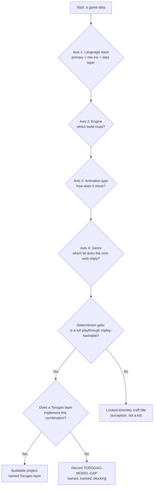
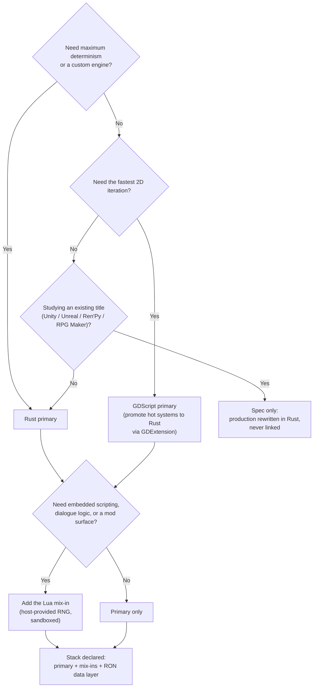
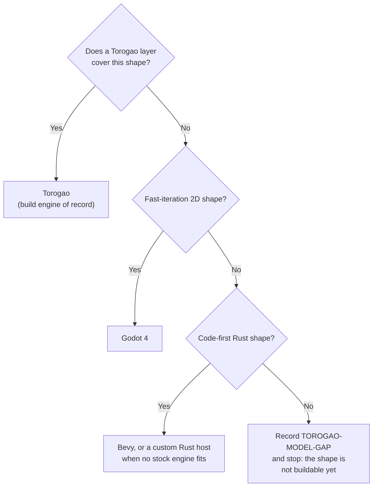
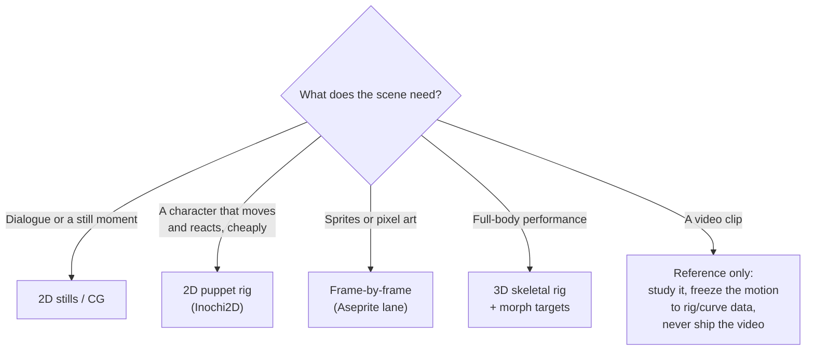
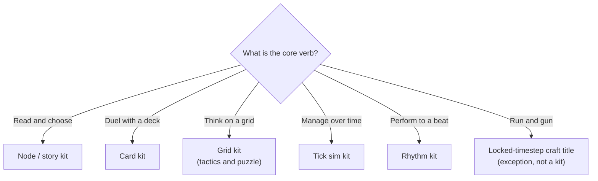

# Phorge

Phorge is the Nice Thoughts Ranch game creation pipeline: one deterministic decision pipeline that takes a game from a blank page to a buildable project by walking four axes in order — **language stack → engine → animation type → genre**. A project is not a pile of preferences; it is the path it took through these trees. Every combination the pipeline emits must either name the Torogao layer that implements it or record a TOROGAO-MODEL-GAP — a named, tracked hole — so nothing is ever silently unbuildable. The full axis catalogue lives in [docs/PIPELINE.md](docs/PIPELINE.md); the trees in full, with reading notes, live in [docs/DECISION-TREES.md](docs/DECISION-TREES.md).

A Nice Thoughts Ranch project.

## The four axes, compactly

1. **Language** — a project declares a *stack*, not a language: one primary plus any of embedded scripting, shader, tooling, and a language-agnostic data layer (RON tables with refusing loaders). Rust is the default primary; Lua is the designated mix-in; GDScript is the fast-iteration primary.
2. **Engine** — Torogao is the singular build engine of record. Bevy, Godot 4, and a custom Rust host are the build routes. Unity, Unreal, Ren'Py, RPG Maker, and GameMaker are study targets: clean-room spec sources, never build targets.
3. **Animation** — 2D stills/CG, frame-by-frame sprites and pixel art, 2D puppet rigs (Inochi2D), 3D skeletal rigs with morph targets, cel loops, composites, parallax plates, kinetic UI. Live2D Cubism is studied and read; production builds in Inochi2D. Video is reference only, never shipped.
4. **Genre** — each genre resolves to a production kit (node/story, card, grid, tick sim, rhythm) or to a named exception: a locked-timestep craft title, or pipeline-excluded.

## Master pipeline

## Axis 1 — Language tree

## Axis 2 — Engine tree

## Axis 3 — Animation tree

## Axis 4 — Genre tree

## Status

Draft 0.1 — axes 1–4. Later axes (platform target, art-production route, audio route, determinism class as a stamped field, lane as a content label) are designed seams, not yet drafted.
