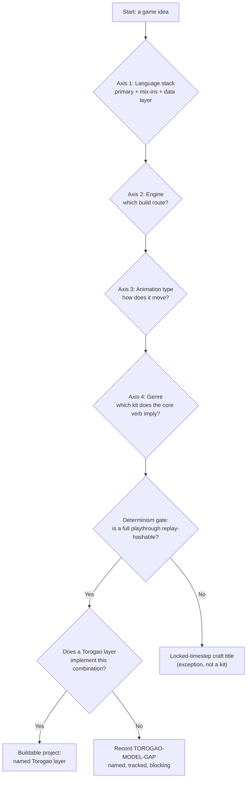
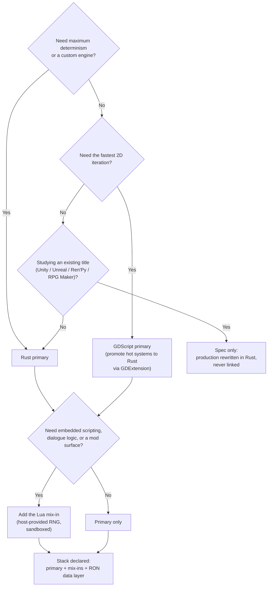
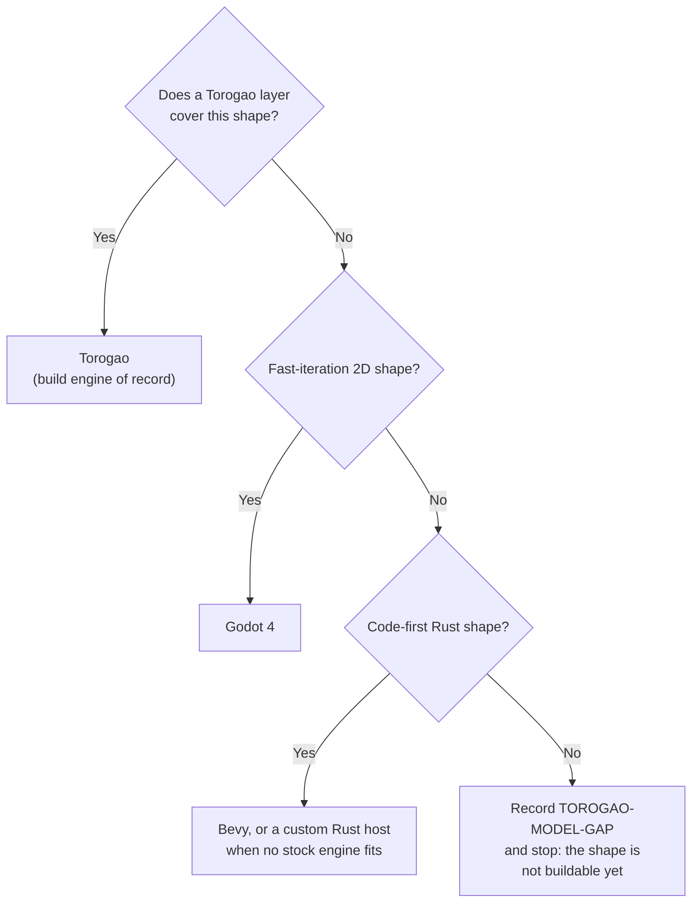
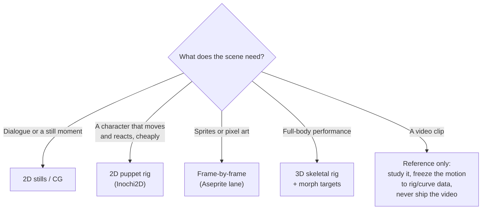
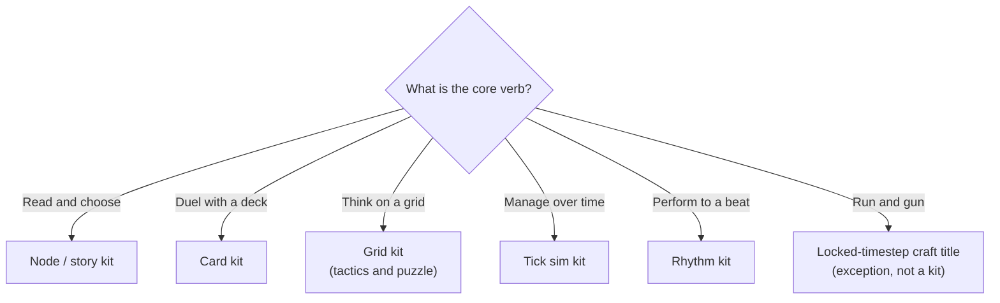

# Phorge decision trees

The five trees a Phorge project walks, in pipeline order. Each tree is a contract: answer the questions honestly, take the branch, and accept what the terminal node obliges. A terminal node is one of three kinds — a **kit** (a production template with a pure core, data tables, and a deterministic smoke test), a **record** (a TOROGAO-MODEL-GAP: a named, tracked hole that blocks the project until the missing capability lands as a Torogao layer), or an **exception** (a craft title built outside the kit system under a locked timestep).

## 1. The master pipeline

**How to read it.** The axes run in a fixed order because each one constrains the next: the language stack bounds what engines are reachable, the engine bounds the animation routes, and the genre is read last because the same genre lands in different kits depending on the choices above it. The determinism gate is the pipeline's quality bar — if a full playthrough cannot be replayed from a seed and hashed byte-identical, the project is not a pipeline project. It may still be built, but as a craft title: one-off, locked-timestep, with its extra gates named up front. The final question is the honesty gate: a combination nobody has implemented yet does not get hand-waved into the plan. It becomes a TOROGAO-MODEL-GAP record, and the project waits on the layer, not on hope.

## 2. Language

**How to read it.** The tree chooses a *stack*, never a single language. Rust is the default terminal because determinism is cheapest there; GDScript is chosen for iteration speed, with the standing obligation that hot or proof-critical systems get promoted into Rust through GDExtension rather than rewritten wholesale. The study branch is the clean-room rule in tree form: a studied title's language produces a specification, and the production code is written fresh in Rust — studied code is never linked, copied, or shipped. The Lua question is asked of every stack, because mixing is a first-class feature: Lua carries gameplay scripts, dialogue logic, and mod surfaces, sandboxed, with all randomness supplied by the host so scripted content stays replay-deterministic. Every path ends at the same obligation: the declared stack, including its language-agnostic RON data layer — the layer that makes the mixing safe.

## 3. Engine

**How to read it.** Torogao is asked first, always: it is the singular build engine of record, and every capability the studio adopts lands there as a layer. Godot and Bevy are not rivals to that rule — they are the proven build routes for shapes Torogao does not yet express, and work done in them feeds back as layer specifications. Unity, Unreal, Ren'Py, RPG Maker, and GameMaker never appear as terminals in this tree at all: they are study targets, read for specifications, and a project that "needs Unity" is really a project whose shape needs naming. If no route fits, the terminal is a record, not a compromise: a TOROGAO-MODEL-GAP is filed and the project stops, honestly, until the layer exists.

## 4. Animation

**How to read it.** The question is asked per scene type, not per game — one title routinely takes several branches. Stills are the cheapest honest answer for dialogue and carry the visual-novel backbone. The puppet branch is the studio's Live2D-shaped answer: Live2D Cubism models are studied and censused, but production builds in Inochi2D to keep the licence chain out of shipped games. The 3D branch obliges the full rig discipline (skeleton plus facial morph targets, exported as glTF) and buys real-time cinematics instead of video files. The video branch is a doctrine terminal: video — generated, captured, or studied — is reference. Its motion gets frozen into deterministic rig/curve data, and the clip itself is never the shipped artifact, because a clip cannot be replay-hashed, re-gated, or re-rendered.

## 5. Genre

**How to read it.** Genres are marketing labels; kits are machinery. The tree therefore asks for the *core verb* — the thing the player does most — and routes to the kit that verb implies: the node/story kit (visual novels, trainers, branching adventure), the card kit (deckbuilders and duels), the grid kit (tactics, puzzles, grid crawlers), the tick sim kit (management and incremental games, balanced by fast-forward simulation), and the rhythm kit (fixed charts, scoring as a pure function of input timing). Each kit terminal obliges the kit's full shape: a pure deterministic core, content as data tables with refusing loaders, and a headless playthrough smoke test. The run-and-gun branch is the honest exception: real-time action leaves the kit system and ships as a locked-timestep craft title, with fixed-step physics as its entry fee. Genres with no branch — sandbox 3D, fighting — are pipeline-excluded, not forgotten: the full genre catalogue, with market weight and determinism fit per genre, is in [PIPELINE.md](PIPELINE.md).
